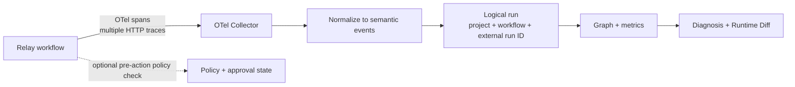

# Agent Runtime V2 demo

This is a 3–5 minute portfolio demo built around real spans emitted by Relay’s deterministic local
COLLABORATE workflow. The mock model and mock providers keep the scenario repeatable; Agent Runtime
does not manufacture telemetry, metrics, errors, or execution differences.

## Prepare

1. Start the two repositories with Relay’s
   [Agent Runtime V2 demo guide](https://github.com/praveenachen/Relay-2.0/blob/main/docs/demos/agent-runtime-v2.md).
   Its Compose override exposes Agent Runtime UI/API on ports `3100`/`8100` and keeps OTLP/HTTP on
   `4318`.
2. Run the Relay healthy COLLABORATE fixture once and the controlled-failure fixture once.
3. From Relay’s `backend/`, run `python scripts/emit_agent_runtime_comparison.py` and save the two
   printed external run IDs.
4. For Runtime Control, seed the Relay demo project, create the example policy below, and enable
   Relay’s Agent Runtime policy client. Keep the approval and queued action ready for the live step.
5. Open Agent Runtime Runs and confirm all expected logical runs are present before presenting.

Do not substitute screenshots or hand-authored spans for missing demo data. If a fixture has not
emitted a metric, the correct value is `—`.

## Architecture at a glance



The grouping identity is application-level. `trace_id`, `span_id`, and real parent relationships
remain on every node. Cross-trace presentation follows timestamps; there are no invented
parent/child edges.

## Presenter script

### 0:00–0:30 — Frame the problem

“Distributed tracing can show which services ran. Agent Runtime explains the semantic workflow:
the agent step, model call, decision, approval, tool call, and failure evidence. It stays outside the
workflow engine and accepts standard OpenTelemetry.”

Open **Runs**. Explain that each row is a logical workflow run, not necessarily one trace.

### 0:30–1:30 — Healthy Relay COLLABORATE

Open the healthy Relay run and make **Run Detail** the centerpiece.

- Point to the Relay WorkflowRun external ID, workflow/version, and trace count.
- Scan the timestamp-ordered graph: `RUN`, `AGENT_STEP`, `LLM_CALL`, `DECISION`, `APPROVAL`, and
  `TOOL_CALL`.
- Select nodes from different traces and show that each retains its own trace and span ID.
- Point to duration/tool counts and only the metrics Relay actually emitted.

Say: “The traces remain intact. Agent Runtime groups them for one operator view and never invents
cross-trace causality.”

### 1:30–2:15 — Controlled failure and diagnosis

Open the controlled Relay failure. Select the real `ERROR`/failed tool node, then open diagnosis.

- Read one observed fact and its affected node reference.
- Distinguish the labeled inferred cause from evidence.
- Note that a partial provider failure can coexist with successful actions elsewhere in the run.

Say: “Diagnosis is evidence-first. The explanation is constrained by recorded facts; it is not a
guess from hidden chain-of-thought.”

### 2:15–3:15 — Runtime Diff

Open **Compare** and select the Relay V1/V2 fixture runs.

- Show the workflow and prompt version changes.
- Show the before/after semantic paths and the added review-request planning behavior.
- Explain added/removed steps and tools as structural differences, not a text diff.
- Point to token and cost as `—` in both runs: Relay did not emit them, so Agent Runtime does not
  claim zero usage.

Say: “Runtime Diff compares configuration, execution structure, and recorded outcomes across whole
logical runs—even when each run contains multiple traces.”

### 3:15–4:30 — Runtime Control

Open **Policies** and show the readable rule:

```text
WHEN side effect = true THEN REQUIRE APPROVAL
```

Trigger the queued Relay action and open **Approvals**.

- Show the action summary, project/run, policy, control reference, expiry, and sanitized context.
- Approve it in Agent Runtime. State clearly that this records authorization; it does not resume
  Relay.
- Manually retry the queued action in Relay with the same control reference.
- Confirm the policy response is allowed by the existing approved approval, the intended queued
  action executes, and the pending approval count does not increase.

Say: “The approval is bound to project, policy revision, logical run, control reference, and a hash
of the sanitized evaluated context. A changed action or policy requires a new approval.”

### 4:30–5:00 — Close

Return to Run Detail.

“Agent Runtime does not replace Relay, LangGraph, or Temporal. It gives any OTel-instrumented agent
a semantic debugging surface, honest metrics, evidence-first diagnosis, safe comparison/replay
metadata, and optional controls for consequential actions.”

## Example policy

```bash
curl -X POST http://localhost:8100/api/v1/policies \
  -H "Content-Type: application/json" \
  -H "X-Agent-Runtime-Principal: relay-local" \
  -d '{"project_id":"11111111-1111-4111-8111-111111111111","name":"Review provider writes","enabled":true,"priority":10,"action":"REQUIRE_APPROVAL","conditions":{"side_effect":true},"fail_closed":true}'
```

Use port `8000` instead when running Agent Runtime’s standalone Compose stack.

## Screenshot checklist

Capture these from a fresh Relay-generated dataset for the README/portfolio page:

- Runs list with readable Relay workflow names and one multi-trace logical run.
- Healthy Run Detail with the full semantic graph visible.
- Controlled failure with the `ERROR` node and evidence panel visible.
- Runtime Diff with version and structural changes plus absent metrics.
- Policy rule and pending approval detail before approval.
- Relay retry result together with an unchanged pending-approval count.

Crop secrets and local identifiers that should not be public. Do not alter values or add illustrative
metrics after capture.

## Limitations to mention if asked

- Relay owns workflow state, retries, product approval, and provider idempotency.
- Agent Runtime approval does not automatically resume a workflow.
- Replay is debugging replay and depends on adapter capabilities; it is not deterministic
  reproduction.
- Baselines need comparable history and expose their coverage/confidence.
- No hidden chain-of-thought is collected.
- Local JSONL storage and permissive local authorization are development defaults, not the complete
  production operating model.
